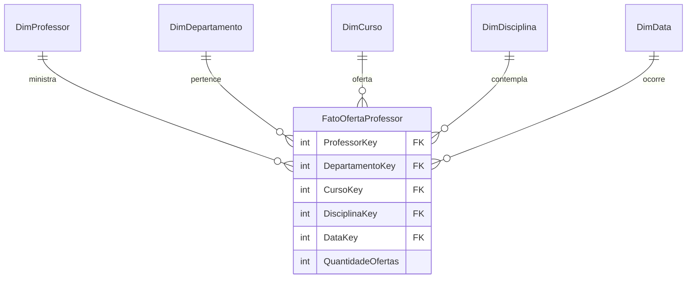

# Desafio Power BI

## DESCRIÇÃO

Projeto desenvolvido durante o bootcamp de Power BI.

## DESAFIO I

O desafio consistiu em:

- Reproduzir duas páginas apresentadas durante as aulas
- Criar uma terceira página utilizando diferentes visualizações
- Trabalhar com mapas, indicadores de lucro e segmentação de dados

### Visuais Desenvolvidos

#### Página 1
Dashboard de vendas.

#### Página 2
Dashboard de desempenho e análises.

#### Página 3

- Mapa de Vendas e Unidades Vendidas por País
- Mapa de Lucro por País
- Gráfico de Pizza com Lucro por Segmento

## DESAFIO II
O desafio consistiu em:
- Botões de navegação que fornecem navegabilidade 
- Segmentadores utilizados e botões com imagem associado 
- Utilização do Painel de Indicadores e botões para selecionar diferentes visuais sobre um mesmo assunto 
#### Página 1
Dashboard de vendas.

#### Página 2
Dashboard de Vendas por País.


<br>

## DESAFIO III

O desafio consistiu em:

- Criar uma instância MySQL no Azure
- Configurar regras de firewall para acesso ao banco de dados
- Conectar ao MySQL utilizando MySQL Workbench
- Integrar o Power BI ao banco MySQL hospedado no Azure
- Realizar transformações e tratamento dos dados utilizando Power Query

### Transformações Realizadas

- Verificação dos cabeçalhos das tabelas
- Ajuste dos tipos de dados
- Conversão dos valores monetários para tipo decimal
- Análise e tratamento de valores nulos
- Verificação de colaboradores sem gerente associado
- Verificação de departamentos sem gerente
- Validação das horas registradas nos projetos
- Separação de colunas compostas
- Criação de coluna com nome completo dos colaboradores
- Mesclagem das tabelas Employee e Department
- Associação de colaboradores aos respectivos departamentos
- Associação de colaboradores aos respectivos gerentes
- Criação de identificador único utilizando Departamento + Localização
- Agrupamento de colaboradores por gerente
- Remoção de colunas desnecessárias para otimização do modelo

### Consulta SQL Utilizada

```sql
SELECT
    e.Ssn,
    CONCAT(e.Fname, ' ', e.Lname) AS Employee_Name,
    CONCAT(m.Fname, ' ', m.Lname) AS Manager_Name
FROM employee e
LEFT JOIN employee m
ON e.Super_ssn = m.Ssn;
```

## DESAFIO IV — Modelagem Dimensional

O desafio consiste em transformar o modelo relacional da Universidade em um
modelo dimensional no formato **star schema**, tendo o **professor** como foco
da análise. O modelo de origem contempla professores, departamentos, cursos e
disciplinas; os relacionamentos N:N entre disciplinas e cursos são resolvidos
pela tabela associativa `Disciplina_Curso`.

### Granularidade e Tabela Fato

A granularidade proposta para `FatoOfertaProfessor` é **uma linha por oferta de
uma disciplina, ministrada por um professor para um curso, em uma data/período
de oferta**. Essa granularidade permite analisar a atuação docente por curso,
disciplina, departamento e tempo.

Como o modelo relacional não contém registros de oferta nem medidas numéricas,
a fato pode ser implementada como uma **tabela fato sem medidas aditivas**,
usando `QuantidadeOfertas = 1` para contar ofertas. As chaves para professor,
departamento, curso, disciplina e data identificam o contexto de cada linha.

### Dimensões

- **DimProfessor** — identificação e atributos descritivos do professor.
- **DimDepartamento** — nome e campus do departamento ao qual o professor
  pertence; o departamento do professor é o contexto usado para essa dimensão.
- **DimCurso** — identificação e atributos descritivos do curso.
- **DimDisciplina** — identificação e atributos descritivos da disciplina.
- **DimData** — data completa, dia, mês, nome do mês, trimestre, semestre e ano,
  permitindo análises em diferentes níveis de tempo.



### Datas e Premissas

Como não há datas no diagrama relacional, as datas de oferta devem ser
complementadas com dados disponíveis ou simulados para o exercício. Pode-se
considerar, por exemplo, a data de oferta da disciplina ou do curso. A
`DimData` deve cobrir o intervalo de datas utilizado e ter uma linha por dia;
se houver mais de um tipo de data, a mesma dimensão pode ser reutilizada em
papéis diferentes, como data da oferta do curso e data da oferta da disciplina.

O relacionamento entre professores e departamentos e a associação
`Disciplina_Curso` servem de base para compor o contexto da fato. As datas de
oferta e a medida `QuantidadeOfertas` são premissas da modelagem, pois não
existem no diagrama de origem. **Dados de alunos e a tabela `Matriculado` não
fazem parte deste desafio.**


## 📁 Estrutura do Projeto
<br>

```text

├── power_bi_analyst/
│   ├── Análise de Dados com SQL/
│   │   ├── sql_script_mysql.sql
│   │   └── sql_script_sqlite.sql
│   ├── dataset/
│   │   ├── Business Unit.csv
│   │   ├── Customer.csv
│   │   ├── Dates.csv
│   │   ├── financial_sample.xlsx
│   │   └── financial_sample_desafio_2.xlsx
│   ├── img/
│   │   ├── clean blue.png
│   │   ├── clean white.png
│   │   └── logo_dio.png
│   ├── sample_financial_desafio_1.pbix
│   ├── sample_financial_desafio_1.pdf
│   ├── relatorio_criativo_desafio_2.pbix
│   ├── mysql_azure_desafio_3.pbix
│   └── modelo_dimensional_professores_desafio_4.mwb
├── .gitignore
└── README.md
```


### Ferramentas

<br>

- Power BI Desktop
- Microsoft Azure
- MySQL
- MySQL Workbench
- PostgreSQL
- DBeaver
- GitHub

### Autor

Golbery Oliveira